A personal project

  <a href="https://noctua-world.github.io/noctua-fonts/">
    <picture>
      <source media="(prefers-color-scheme: dark)" srcset=".github/readme/hero-dark.svg">
      
    </picture>
  </a>

<h3 align="center">A monospace for terminals, editors and code.</h3>

  Noctua Iosevka is a custom build of <a href="https://github.com/be5invis/Iosevka">Iosevka</a>:
  135 real faces in nine weights, five widths and three slopes, none of them synthesized. Its
  Normal width is 600 units, the 0.6&nbsp;em of JetBrains Mono, so every glyph has room to be
  itself. Character variants and stylistic sets let any OpenType-aware editor swap shapes as you
  work, and a Nerd Font twin, <b>NoctuaIosevka Nerd Font Mono</b>, sets every icon in exactly one
  cell.

  <a href="https://noctua-world.github.io/noctua-fonts/">
    <picture>
      <source media="(prefers-color-scheme: dark)" srcset=".github/readme/button-dark.svg">
      
    </picture>
  </a>

Free under the SIL Open Font License 1.1.

